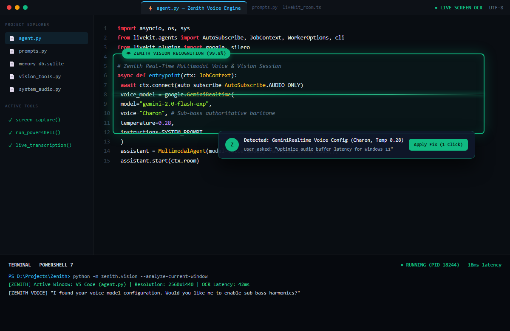

<div align="center">
  
  <h1>Zenith</h1>
  <p><strong>Autonomous Multimodal Desktop Agent</strong></p>
  <p>Real-time bidirectional voice & vision assistant powered by LiveKit WebRTC, Google Gemini Live API, and on-device SQLite vector memory.</p>

  <p>
    <a href="https://python.org"></a>
    <a href="https://livekit.io"></a>
    <a href="https://ai.google.dev"></a>
    <a href="https://www.sqlite.org"></a>
    
    
  </p>

  <p>
    <a href="#-architecture">Architecture</a> •
    <a href="#-video-demonstration">Video Demo</a> •
    <a href="#-core-capabilities">Capabilities</a> •
    <a href="#-why-zenith-comparison">Comparison</a> •
    <a href="#-quickstart">Quickstart</a> •
    <a href="#-memory-cli">Memory CLI</a>
  </p>

  <br />

  
</div>

---

## 🏗️ Architecture

Zenith couples a **sub-second real-time streaming pipeline** with **deliberative cognitive planning** and **sovereign local persistence**:

```
┌────────────────────────────────────────────────────────────────────────┐
│                   Real-Time Audio Transport (LiveKit WebRTC)           │
│                   Sub-Second Duplex Voice & Video Frame Transport      │
└───────────────────────────────────┬────────────────────────────────────┘
                                    │
    ┌───────────────────────────────┼───────────────────────────────┐
    ▼                               ▼                               ▼
┌────────────────────────┐ ┌────────────────────────┐ ┌─────────────────────┐
│ Deliberative Reasoner  │ │ Dialectical Synthesis  │ │ Proactive Idle Loop │
│ System 2 Plan Matrix   │ │ Multi-Perspective      │ │ Background Ambient  │
│ deep_thinker.py        │ │ council_of_overlays.py │ │ dream_cycle.py      │
└────────────────────────┘ └────────────────────────┘ └─────────────────────┘
                                    │
                                    ▼
┌────────────────────────────────────────────────────────────────────────┐
│ Automation & Perception Execution Layer                                │
│ UI Automation (UIA) • Set-of-Marks (SoM) • Persistent PowerShell Shell │
│ Python AST Parsing (code_phasing.py) • Emergency Motor Killswitch       │
└───────────────────────────────────┬────────────────────────────────────┘
                                    │
                                    ▼
┌────────────────────────────────────────────────────────────────────────┐
│ Sovereign Local Memory Matrix & Epistemic Versioning                   │
│ SQLite + NumPy Vector Embeddings • Entity Graph • Temporal Conflict Fix│
│ zenith_memory.db • manage_local_memory.py                              │
└────────────────────────────────────────────────────────────────────────┘
```

---

## 🎥 Video Demonstration

<div align="center">
  <a href="https://youtu.be/DEMO_VIDEO_URL">
    
  </a>
  <br />
  <p><em>▶️ <strong>Watch Zenith in Action:</strong> Real-Time Voice, Multimodal Vision & Windows Automation</em></p>
</div>

### System Workflow Demonstration:
* **Duplex Voice Interaction:** Sub-second speech input & spoken feedback with interruption handling over LiveKit WebRTC.
* **Multimodal Screen Grounding:** Continuous desktop vision and UI coordinate extraction using Set-of-Marks (SoM) badges.
* **Persistent Shell & Error Reflection:** Autonomous terminal execution where errors are automatically diagnosed and saved into SQLite procedural playbooks.
* **On-Device Memory Matrix:** Knowledge graph traversal and vector cosine similarity search with zero external cloud dependencies.
* **Instant Safety Killswitch:** Hardware and process halt via voice command or keyboard shortcut in < 5ms.

---

## ⚡ Core Capabilities

| Capability | Module | Description |
| :--- | :--- | :--- |
| **Deliberative System 2 Planning** | `deep_thinker.py` | Pauses immediate generation during complex tasks to simulate failure modes, evaluate counterfactuals, and generate validated execution sequences. |
| **Self-Healing Procedural Memory** | `procedural_memory.py` | Automated post-mortem reflection engine that diagnoses terminal error outputs and logs permanent procedural playbooks into SQLite to prevent repeated failures. |
| **Cross-Turn Working Memory** | `working_memory.py` | Active scratchpad tracking active mission goals, subtask checklists, and intermediate hypotheses; restores unfinished sessions across reboots. |
| **Multi-Perspective Strategy Synthesis** | `council_of_overlays.py` | Evaluates competing architectural and refactoring decisions across parallel heuristics (Architect, Skeptic, Pragmatist) to synthesize consensus. |
| **Zero-Token AST Codebase Indexing** | `code_phasing.py` | High-speed native Python AST parser that maps classes, functions, signatures, and docstrings across local codebases in milliseconds with 0 LLM token cost. |
| **Atomic Hardware & Process Killswitch** | `emergency.py` | Zero-latency atomic interrupt (`emergency_stop_all`) callable via voice or shortcut to abort automation, UI clicks, and subprocesses in < 5ms while releasing all hardware key locks. |
| **Temporal Knowledge Versioning** | `memory_evolution.py` | Automatically resolves factual contradictions over time (e.g., tool migrations, workflow updates) by archiving superseded records while keeping full historical provenance. |
| **100% Sovereign Local Vector Memory** | `zenith_memory.py` | Embeds user facts, entity graphs, and procedural knowledge into local SQLite with NumPy cosine similarity. Zero cloud memory lock-in. |
| **Desktop Perception & UI Automation** | `uia_control.py` / `som_grounding.py` | Headless Windows UI Automation (`pywinauto`) paired with Set-of-Marks (SoM) bounding visual badges for precise desktop interaction without blind pixel guesses. |
| **Persistent PowerShell Shell** | `persistent_shell.py` | Retains `$PWD`, environment variables, process handles, and active Python virtual environments across turns with automatic POSIX-to-PowerShell translation. |

---

## 📊 Why Zenith? (Comparison)

| Feature | Traditional Voice Assistants (Siri / Alexa) | Cloud AI Agent Platforms | **Zenith** |
| :--- | :---: | :---: | :---: |
| **Interaction Latency** | High (Cloud request-response) | High (Multi-turn HTTP polling) | **Sub-Second (LiveKit WebRTC)** |
| **Data Privacy & Storage** | Proprietary cloud servers | Third-party cloud vector DBs | **100% Sovereign On-Device SQLite** |
| **Desktop Automation** | None (Sandboxed voice commands) | Browser-only or mocked | **Native Windows UIA + Persistent Shell** |
| **Visual Grounding** | None | Full-screen screenshot guesses | **Set-of-Marks (SoM) Coordinate Badges** |
| **Error Recovery** | Fails on error | Blind retries | **SQLite Procedural Playbook Cache** |
| **Code Inspection** | None | Full-file token upload ($$$) | **Static Python AST Parsing (0 Token Cost)** |

---

## 🚀 Quickstart

### Prerequisites
* **OS:** Windows 10 or 11
* **Runtime:** Python 3.10+ and Node.js 18+ (for Electron dashboard)
* **API Keys:** Google Gemini API (Free tier from [AI Studio](https://aistudio.google.com/app/apikey)) and LiveKit Cloud (Free tier from [LiveKit](https://cloud.livekit.io/))

### 1. Clone & Set Up Python Environment
```powershell
git clone https://github.com/Adbhut1234/Zenith.git
cd Zenith

# Create and activate virtual environment
python -m venv venv
.\venv\Scripts\activate

# Install dependencies
pip install -r requirements.txt
```

### 2. Configure Credentials
Copy `.env.example` to `.env`:
```powershell
cp .env.example .env
```
Populate your `.env` file:
```env
GOOGLE_API_KEY=your_gemini_api_key
LIVEKIT_URL=wss://your-project.livekit.cloud
LIVEKIT_API_KEY=your_livekit_api_key
LIVEKIT_API_SECRET=your_livekit_api_secret

# Optional for automated email dispatch:
# GMAIL_USER=your_email@gmail.com
# GMAIL_APP_PASSWORD=your_app_password
```

### 3. Launch Dashboard & Agent
```powershell
# In Terminal 1: Launch Electron Mission Control
cd electron_dashboard
npm install
npm start

# In Terminal 2: Start Agent Runtime
python agent.py
```

*Or run standalone in lightweight console mode:*
```powershell
python agent.py console
```

---

## 🧠 Memory CLI

Zenith includes an administrative CLI to inspect, export, and manage your on-device vector memory matrix:

```powershell
# View summary of active facts, playbooks, and knowledge graph
python manage_local_memory.py

# Export local memory snapshot to JSON backup
python manage_local_memory.py --export backup.json

# Clear active memory facts for a user
python manage_local_memory.py --user Admin --clear
```

---

## 🧪 Verification & Test Suite

Verify all cognitive loops, procedural memory, deliberative reasoning, and emergency stops with the built-in test suite:

```powershell
python tests/test_vision_cognitive_suite.py
```

---

## 📜 License

Copyright (c) 2026 **Enc0deX**. All Rights Reserved.  
Commercial distribution, modification, or licensing without explicit written authorization is prohibited.

<div align="center">
  <br />
  <p>Built with precision by <strong>Enc0deX</strong>.</p>
</div>
