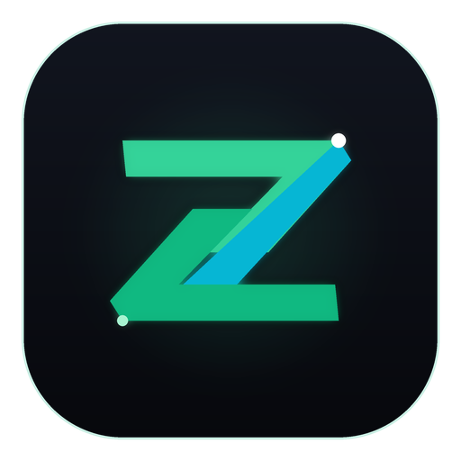
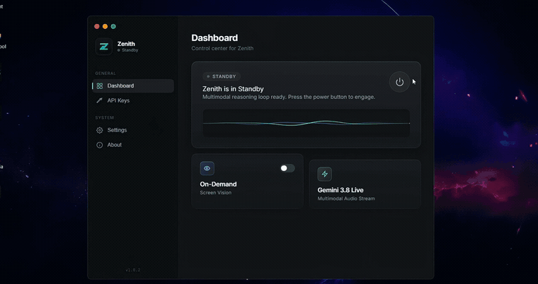

<div align="center">
  
  <h1>Zenith</h1>
  <p><strong>Autonomous Multimodal Desktop Agent for Windows</strong></p>
  <p>Real-time bidirectional voice & vision assistant powered by LiveKit WebRTC, Gemini Live API, and on-device SQLite vector memory.</p>

  <p>
    
    <a href="https://python.org"></a>
    
    <a href="https://livekit.io"></a>
    <a href="https://ai.google.dev"></a>
    <a href="https://www.sqlite.org"></a>
  </p>

  <br />

  
</div>

---

## Highlights

- ⚡ **Low-Latency Duplex Voice:** Full-duplex conversational audio streaming over LiveKit WebRTC with live speech interruption.
- 👁️ **Desktop Perception:** Targeted UI navigation combining Set-of-Marks (SoM) visual bounding badges with Windows UI Automation (`pywinauto`).
- 🧠 **On-Device Vector Memory:** 100% local SQLite vector storage with NumPy cosine similarity — conversation memory and facts never leave your machine.
- 🛠️ **Error-Aware Shell & Playbooks:** Maintains persistent PowerShell state across turns and automatically saves procedural recovery playbooks from shell errors.
- 🛑 **Software Emergency Killswitch:** Near-instant automation abort and hardware input release callable via voice command or keyboard shortcut.

---

## Architecture

```
[ Microphone / Screen ] ──(WebRTC)──> [ LiveKit Engine ] ──> [ Gemini Live API ]
                                                                     │
                                                                     ▼
[ Desktop Automation ] <── [ Persistent Shell ] <── [ System 2 Reasoning ]
(UIA + Set-of-Marks)       (Stateful PowerShell)              │
                                                              ▼
                                                   [ SQLite Vector Store ]
                                                   (Local Facts & Playbooks)
```

---

## Core Modules & Project Structure

| Module | Location | Purpose |
| :--- | :--- | :--- |
| **Agent Core Daemon** | `agent.py` | Orchestrates the LiveKit worker session and Gemini Live multimodal streaming loop. |
| **System 2 Planner** | `agent_tools/deep_thinker.py` | Deliberative planner that simulates and validates multi-step CLI operations before execution. |
| **Procedural Memory** | `agent_tools/procedural_memory.py` | Diagnoses terminal errors and logs procedural recovery playbooks to SQLite. |
| **Working Memory** | `agent_tools/working_memory.py` | Cross-turn active cognitive scratchpad tracking task checklists and intermediate hypotheses. |
| **AST Code Indexer** | `agent_tools/code_phasing.py` | Python AST parser that extracts symbols and signatures across repos with 0 LLM token cost. |
| **Emergency Stop** | `agent_tools/emergency.py` | Atomic killswitch that halts spawned processes and releases hardware keys. |
| **Desktop Automation** | `uia_control.py` / `som_grounding.py` | Native Windows UIA controls paired with Set-of-Marks coordinate mapping. |
| **Local Memory Matrix** | `zenith_memory.py` | Embedded SQLite database storing vector embeddings, entity graphs, and fact versions. |

---

## Quickstart

### Prerequisites
* **Operating System:** Windows 10 or 11 (required for Windows UI Automation & persistent PowerShell)
* **Python:** 3.10 or higher
* **Node.js:** 18 or higher (for the Electron dashboard)
* **API Keys:** Google Gemini API ([AI Studio](https://aistudio.google.com/app/apikey)) and LiveKit Cloud ([LiveKit](https://cloud.livekit.io/))

### 1. Clone & Set Up Python Environment
```powershell
git clone https://github.com/Adbhut1234/Zenith.git
cd Zenith

python -m venv venv
.\venv\Scripts\activate
pip install -r requirements.txt
```

### 2. Configure Credentials
Copy `.env.example` to `.env`:
```powershell
cp .env.example .env
```
Add your Gemini and LiveKit keys to `.env`:
```env
GOOGLE_API_KEY=your_gemini_api_key
LIVEKIT_URL=wss://your-project.livekit.cloud
LIVEKIT_API_KEY=your_livekit_api_key
LIVEKIT_API_SECRET=your_livekit_api_secret
```

### 3. Launch
```powershell
# Option A: Full Electron Dashboard
cd electron_dashboard
npm install
npm start

# Option B: Lightweight Console Mode (from project root)
python agent.py console
```

---

## 🔒 Safety, Privacy & Limitations

* **Confirmation Safeguard:** Zenith supports confirmation gating (`REQUIRE_CMD_CONFIRMATION=true` in `.env`) so the agent pauses and asks for user approval before executing sensitive commands.
* **Privacy Boundary:** Audio and active screen frames stream via WebRTC to Google Gemini and LiveKit for real-time model inference. All conversation memory, user facts, and error playbooks remain **100% on-device in `zenith_memory.db`**.
* **Emergency Abort:** Say *"Stop everything"*, *"Abort"*, or *"Freeze"* (or trigger the emergency shortcut) to immediately kill active automation tasks and release hardware input locks.
* **Platform Support:** Zenith is experimental and currently **Windows-only**, relying on native Windows UI Automation (UIA) and PowerShell session state.

---

## Memory Management

Zenith includes a CLI to inspect and manage your local SQLite memory matrix:

```powershell
# View summary of stored facts, playbooks, and knowledge graph
python manage_local_memory.py

# Export local memory snapshot to JSON backup
python manage_local_memory.py --export backup.json

# Clear active memory facts for a specific profile
python manage_local_memory.py --user Admin --clear
```

---

## Verification & Tests

To run the verification test suite covering cognitive loops, procedural memory, and the emergency stop:

```powershell
python tests/test_vision_cognitive_suite.py
```

---

## License

Copyright (c) 2026 **Enc0deX**. All Rights Reserved.

---

## 🎬 Live Demonstration

<div align="center">
  
</div>

