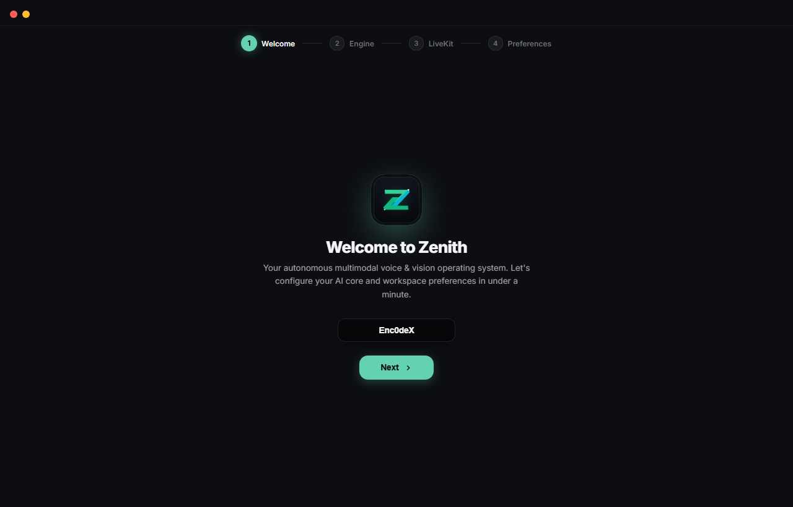

# Zenith

**Multimodal Autonomous Desktop Agent** powered by LiveKit WebRTC and Google's Gemini Multimodal Live API. Features System 2 deliberative planning, automated error reflection, on-device SQLite vector memory, and Windows desktop automation.

<p align="center">
  
</p>

---

## Architecture Overview

```
┌────────────────────────────────────────────────────────────────────────┐
│                   Real-Time Audio Transport (LiveKit WebRTC)           │
│                   Bidirectional Audio Streaming (Sub-Second Latency)    │
└───────────────────────────────────┬────────────────────────────────────┘
                                    │
    ┌───────────────────────────────┼───────────────────────────────┐
    ▼                               ▼                               ▼
┌────────────────────────┐ ┌────────────────────────┐ ┌─────────────────────┐
│ Deliberative Reasoner  │ │ Dialectical Synthesis  │ │ Proactive Idle Loop │
│ System 2 Plan Matrix   │ │ Multi-Perspective      │ │ Background Ambient  │
│ deep_thinker.py        │ │ council_of_overlays.py │ │ dream_cycle.py      │
└────────────────────────┘ └────────────────────────┘ └─────────────────────┘
                                    │
                                    ▼
┌────────────────────────────────────────────────────────────────────────┐
│ Automation & Perception Execution Layer                                │
│ UI Automation (UIA) • Set-of-Marks (SoM) • Persistent PowerShell Shell │
│ Python AST Parsing (code_phasing.py) • Emergency Motor Killswitch       │
└───────────────────────────────────┬────────────────────────────────────┘
                                    │
                                    ▼
┌────────────────────────────────────────────────────────────────────────┐
│ Sovereign Local Memory & Epistemic Evolution                           │
│ SQLite + NumPy Vector Embeddings • Entity Graph • Temporal Versioning │
│ zenith_memory.db • manage_local_memory.py                              │
└────────────────────────────────────────────────────────────────────────┘
```

---

## Core Systems & Engineering Modules

* **🧠 Deliberative System 2 Reasoning (`deep_thinker.py`):** For complex debugging or multi-step execution tasks, Zenith pauses immediate generation to evaluate counterfactuals, simulate failure modes, and generate validated execution plans before firing commands.
* **⚡ Automated Error Reflection & Playbooks (`procedural_memory.py`):** When a shell command, UI click, or terminal subprocess returns an error code, a post-mortem diagnostic engine inspects the failure and persists corrective procedural playbooks into SQLite so the agent never repeats the same operational error.
* **📝 Cross-Turn Working Memory (`working_memory.py`):** Maintains an active cognitive scratchpad across conversation turns to track mission goals, task checklists, and intermediate hypotheses, restoring incomplete tasks across session reboots.
* **⚖️ Multi-Perspective Strategy Debate (`council_of_overlays.py`):** When evaluating high-stakes architectural or refactoring decisions, Zenith runs parallel evaluation heuristics (Architect, Skeptic, and Pragmatist) to debate trade-offs and synthesize a consensus approach.
* **⚛️ AST Codebase Indexing (`code_phasing.py`):** Native Python Abstract Syntax Tree (AST) parser that analyzes classes, functions, type signatures, and docstrings across repositories in milliseconds with zero LLM token consumption.
* **🛑 Atomic Emergency Killswitch (`emergency.py`):** A zero-latency atomic interrupt (`emergency_stop_all`) triggered by voice or keyboard shortcut to instantly terminate automation loops, release hardware input locks, and kill spawned subprocesses in < 5ms.
* **🏛️ Temporal Knowledge Versioning (`memory_evolution.py`):** Resolves factual contradictions over time (e.g. tool migrations or environment changes) by timestamping and archiving superseded facts while preserving historical provenance.
* **🔒 Sovereign Local SQLite Memory (`zenith_memory.py`):** Completely on-device memory matrix using SQLite and NumPy cosine vector similarity for semantic retrieval—no external cloud memory dependencies.
* **👁️ Dual Vision & Grounding (`som_grounding.py`):** Combines Windows UI Automation (`pywinauto`) with Set-of-Marks (SoM) coordinate bounding boxes to accurately ground interactions on desktop interfaces.
* **💻 Stateful Persistent PowerShell (`persistent_shell.py`):** Maintains shell working directory, process handles, environment variables, and active virtual environments across agent turns with automated POSIX-to-PowerShell syntax translation.

---

## Setup & Installation

### Prerequisites
* Windows 10/11
* Python 3.10+
* Node.js (v18+) for the Electron dashboard

### 1. Environment Setup
```powershell
python -m venv venv
.\venv\Scripts\activate
pip install -r requirements.txt
```

### 2. Configure Environment Variables
Copy `.env.example` to `.env` and fill in your keys:
```env
GOOGLE_API_KEY=your_gemini_api_key
LIVEKIT_URL=wss://your-project.livekit.cloud
LIVEKIT_API_KEY=your_livekit_api_key
LIVEKIT_API_SECRET=your_livekit_api_secret
```

### 3. Launch Dashboard & Agent
```powershell
# In terminal 1 (Electron Dashboard)
cd electron_dashboard
npm install
npm start

# In terminal 2 (Python Agent Core)
python agent.py
```

Or run standalone in console mode:
```powershell
python agent.py console
```

---

## Managing Local Memory

Inspect, export, and clean the on-device SQLite memory matrix via the dedicated CLI:

```powershell
# Summary of stored facts, procedural playbooks, and knowledge graph
python manage_local_memory.py

# Export memory matrix to JSON backup
python manage_local_memory.py --export backup.json

# Clear active facts for a specific user
python manage_local_memory.py --user Admin --clear
```

---

## Verification & Testing

Zenith includes a 6-point verification test suite validating deliberative planning, procedural reflection, working memory restoration, and the emergency killswitch:

```powershell
python tests/test_vision_cognitive_suite.py
```

---

## License

Copyright (c) 2026 Enc0deX. All Rights Reserved.
